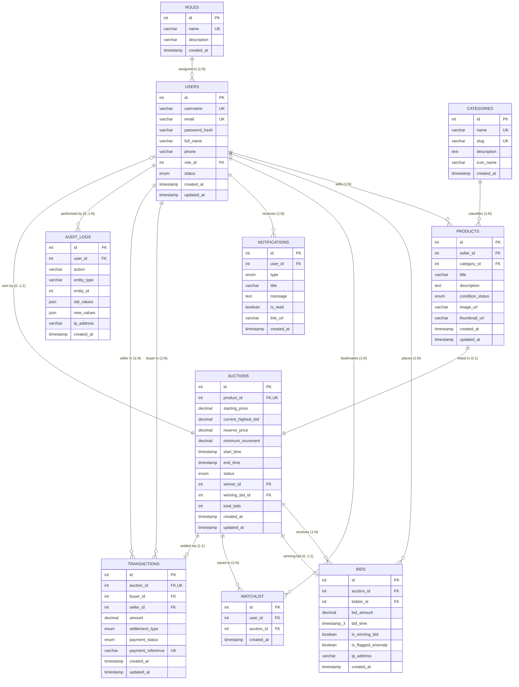

# BidSmart Analytics — Entity-Relationship Diagram (ERD) & Data Model Specification

## 1. Visual Entity-Relationship Diagram (Mermaid)



---

## 2. Table-by-Table Architectural Specification

### 2.1 `roles`
- **Purpose:** System security roles defining access entitlements (RBAC).
- **Primary Key:** `id` (INT, AUTO_INCREMENT)
- **Unique Keys:** `name` (`'BUYER'`, `'SELLER'`, `'ADMIN'`)
- **Relationships:**
  - One-to-Many with `users`: A role can be assigned to multiple users. `ON DELETE RESTRICT ON UPDATE CASCADE`.

### 2.2 `users`
- **Purpose:** Core user account entity for buyers, sellers, and administrators.
- **Primary Key:** `id` (INT, AUTO_INCREMENT)
- **Unique Keys:** `username`, `email`
- **Foreign Keys:**
  - `role_id` $\rightarrow$ `roles(id)` (ON DELETE RESTRICT ON UPDATE CASCADE)
- **Indexes:**
  - `idx_users_role` (`role_id`): Rapid authorization lookups.
  - `idx_users_status` (`status`): Filtering active vs suspended accounts.
- **Relationships:**
  - One-to-Many with `products` (as `seller_id`)
  - One-to-Many with `bids` (as `bidder_id`)
  - One-to-Many with `auctions` (as `winner_id`)
  - One-to-Many with `watchlist` (as `user_id`)
  - One-to-Many with `notifications` (as `user_id`)
  - One-to-Many with `transactions` (as `buyer_id` and `seller_id`)
  - One-to-Many with `audit_logs` (as `user_id`)

### 2.3 `categories`
- **Purpose:** Standardized hierarchical classification for catalog items and analytics.
- **Primary Key:** `id` (INT, AUTO_INCREMENT)
- **Unique Keys:** `name`, `slug`
- **Relationships:**
  - One-to-Many with `products`: Each product belongs to exactly one category.

### 2.4 `products`
- **Purpose:** Tangible/digital assets submitted by sellers for auction listing.
- **Primary Key:** `id` (INT, AUTO_INCREMENT)
- **Foreign Keys:**
  - `seller_id` $\rightarrow$ `users(id)` (ON DELETE RESTRICT ON UPDATE CASCADE)
  - `category_id` $\rightarrow$ `categories(id)` (ON DELETE RESTRICT ON UPDATE CASCADE)
- **Indexes:**
  - `FULLTEXT INDEX ft_products_title_desc (title, description)`: High-performance natural language search.
  - `idx_products_category (category_id)`
  - `idx_products_seller (seller_id)`
- **Relationships:**
  - One-to-One with `auctions`: Each product corresponds to exactly one auction lifecycle.

### 2.5 `auctions`
- **Purpose:** Central state machine managing bidding windows, price thresholds, and winner resolution.
- **Primary Key:** `id` (INT, AUTO_INCREMENT)
- **Unique Keys:** `product_id` (enforces strict 1:1 listing relationship)
- **Foreign Keys:**
  - `product_id` $\rightarrow$ `products(id)` (ON DELETE CASCADE ON UPDATE CASCADE)
  - `winner_id` $\rightarrow$ `users(id)` (ON DELETE SET NULL ON UPDATE CASCADE)
  - `winning_bid_id` $\rightarrow$ `bids(id)` (ON DELETE SET NULL ON UPDATE CASCADE)
- **Constraints:**
  - `chk_auction_times`: `CHECK (end_time > start_time)`
  - `chk_starting_price`: `CHECK (starting_price >= 0.01)`
  - `chk_minimum_increment`: `CHECK (minimum_increment >= 0.01)`
- **Indexes:**
  - `idx_auctions_status_end_time (status, end_time)`: Critical for sub-millisecond background closure queries (`WHERE status = 'ACTIVE' AND end_time <= NOW()`).
  - `idx_auctions_winner (winner_id)`
  - `idx_auctions_highest_bid (current_highest_bid)`

### 2.6 `bids`
- **Purpose:** Append-only, immutable financial ledger recording every bid placed.
- **Primary Key:** `id` (INT, AUTO_INCREMENT)
- **Foreign Keys:**
  - `auction_id` $\rightarrow$ `auctions(id)` (ON DELETE CASCADE ON UPDATE CASCADE)
  - `bidder_id` $\rightarrow$ `users(id)` (ON DELETE RESTRICT ON UPDATE CASCADE)
- **Constraints:**
  - `chk_bid_amount`: `CHECK (bid_amount >= 0.01)`
- **Precision:** `bid_time TIMESTAMP(3)`: Millisecond resolution for accurate sequence ranking and burst detection.
- **Indexes:**
  - `idx_bids_auction_amount (auction_id, bid_amount DESC)`: Sub-millisecond retrieval of the highest current bid.
  - `idx_bids_bidder (bidder_id)`: Buyer dashboard history lookups.
  - `idx_bids_time (bid_time)`: Time-series analytics aggregations.
  - `idx_bids_flagged (is_flagged_anomaly)`: Surveillance review queue filtering.
  - `idx_bids_auction_time (auction_id, bid_time)`: High-frequency burst and sniping analytics.

### 2.7 `watchlist`
- **Purpose:** Personal bookmarks enabling buyers to monitor listings without bidding.
- **Primary Key:** `id` (INT, AUTO_INCREMENT)
- **Unique Composite Key:** `uq_user_auction_watchlist (user_id, auction_id)` prevents duplicate bookmarks.
- **Foreign Keys:**
  - `user_id` $\rightarrow$ `users(id)` (ON DELETE CASCADE ON UPDATE CASCADE)
  - `auction_id` $\rightarrow$ `auctions(id)` (ON DELETE CASCADE ON UPDATE CASCADE)

### 2.8 `notifications`
- **Purpose:** Asynchronous and in-app alert dispatcher.
- **Primary Key:** `id` (INT, AUTO_INCREMENT)
- **Foreign Keys:**
  - `user_id` $\rightarrow$ `users(id)` (ON DELETE CASCADE ON UPDATE CASCADE)
- **Indexes:**
  - `idx_notifications_user_read (user_id, is_read)`: Fast unread notification badge counters.

### 2.9 `transactions` (Simulated Demo Settlement)
- **Purpose:** Records non-monetary demo escrow settlements for completed auctions.
- **Primary Key:** `id` (INT, AUTO_INCREMENT)
- **Unique Keys:** `auction_id` (1:1 with completed auction), `payment_reference` (`TX-DEMO-XXXXX`)
- **Foreign Keys:**
  - `auction_id` $\rightarrow$ `auctions(id)` (ON DELETE RESTRICT ON UPDATE CASCADE)
  - `buyer_id` $\rightarrow$ `users(id)` (ON DELETE RESTRICT ON UPDATE CASCADE)
  - `seller_id` $\rightarrow$ `users(id)` (ON DELETE RESTRICT ON UPDATE CASCADE)
- **Constraints:**
  - `chk_transaction_amount`: `CHECK (amount >= 0.01)`
- **Indexes:**
  - `idx_transactions_status (payment_status)`

### 2.10 `audit_logs`
- **Purpose:** Immutable governance audit log tracking administrative, financial, and anomaly events.
- **Primary Key:** `id` (INT, AUTO_INCREMENT)
- **Foreign Keys:**
  - `user_id` $\rightarrow$ `users(id)` (ON DELETE SET NULL ON UPDATE CASCADE)
- **Payload Columns:** `old_values JSON`, `new_values JSON` for detailed before-and-after change diffs.
- **Indexes:**
  - `idx_audit_action (action)`
  - `idx_audit_created (created_at)`
  - `idx_audit_user (user_id)`

---

## 3. Cardinality and Referential Integrity Rules

| Parent Table | Child Table | Cardinality | Foreign Key Constraint | Delete Action | Update Action |
| :--- | :--- | :---: | :--- | :--- | :--- |
| `roles` | `users` | 1 : N | `users.role_id` $\rightarrow$ `roles.id` | **RESTRICT** | **CASCADE** |
| `users` (Seller) | `products` | 1 : N | `products.seller_id` $\rightarrow$ `users.id` | **RESTRICT** | **CASCADE** |
| `categories` | `products` | 1 : N | `products.category_id` $\rightarrow$ `categories.id` | **RESTRICT** | **CASCADE** |
| `products` | `auctions` | 1 : 1 | `auctions.product_id` $\rightarrow$ `products.id` | **CASCADE** | **CASCADE** |
| `auctions` | `bids` | 1 : N | `bids.auction_id` $\rightarrow$ `auctions.id` | **CASCADE** | **CASCADE** |
| `users` (Bidder) | `bids` | 1 : N | `bids.bidder_id` $\rightarrow$ `users.id` | **RESTRICT** | **CASCADE** |
| `users` (Winner) | `auctions` | 1 : N | `auctions.winner_id` $\rightarrow$ `users.id` | **SET NULL** | **CASCADE** |
| `bids` (Winning) | `auctions` | 1 : 1 | `auctions.winning_bid_id` $\rightarrow$ `bids.id` | **SET NULL** | **CASCADE** |
| `users` | `watchlist` | 1 : N | `watchlist.user_id` $\rightarrow$ `users.id` | **CASCADE** | **CASCADE** |
| `auctions` | `watchlist` | 1 : N | `watchlist.auction_id` $\rightarrow$ `auctions.id` | **CASCADE** | **CASCADE** |
| `users` | `notifications` | 1 : N | `notifications.user_id` $\rightarrow$ `users.id` | **CASCADE** | **CASCADE** |
| `auctions` | `transactions` | 1 : 1 | `transactions.auction_id` $\rightarrow$ `auctions.id` | **RESTRICT** | **CASCADE** |
| `users` (Buyer) | `transactions` | 1 : N | `transactions.buyer_id` $\rightarrow$ `users.id` | **RESTRICT** | **CASCADE** |
| `users` (Seller) | `transactions` | 1 : N | `transactions.seller_id` $\rightarrow$ `users.id` | **RESTRICT** | **CASCADE** |
| `users` | `audit_logs` | 1 : N | `audit_logs.user_id` $\rightarrow$ `users.id` | **SET NULL** | **CASCADE** |

---

## 4. Auction Lifecycle State Machine

```
              +-------------------+
              |       DRAFT       |
              +---------+---------+
                        | (Seller schedules listing)
                        v
              +-------------------+
              |     SCHEDULED     |
              +---------+---------+
                        | (start_time reached)
                        v
              +-------------------+
              |      ACTIVE       |<--------+ (New valid bid placed;
              +---------+---------+         |  anti-sniping extension if <30s)
                        |                   |
                        +-------------------+
                        |
                        | (end_time reached)
                        v
              +-------------------+
              |    EXPIRATION     |
              |   EVALUATION      |
              +----+----+----+----+
                   |    |    |
       (Bids >= 1  |    |    | (0 Bids placed)
   and Reserve Met)|    |    v
                   |    |  +-------------------+
                   |    |  |      UNSOLD       |
                   |    |  +-------------------+
                   |    |
                   |    | (Bids placed, but
                   |    |  highest < reserve)
                   |    v
                   |  +-------------------+
                   |  |  RESERVE_NOT_MET  |
                   |  +-------------------+
                   v
         +-------------------+
         |     COMPLETED     |
         +---------+---------+
                   | (Winner resolved, Transaction created)
                   v
         +-------------------+
         |  DEMO SETTLEMENT  |
         +-------------------+
```
