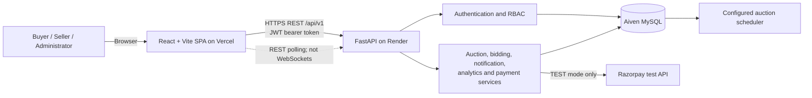
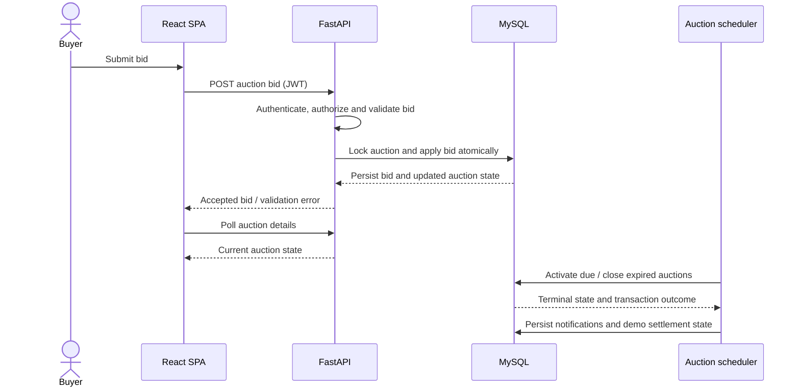
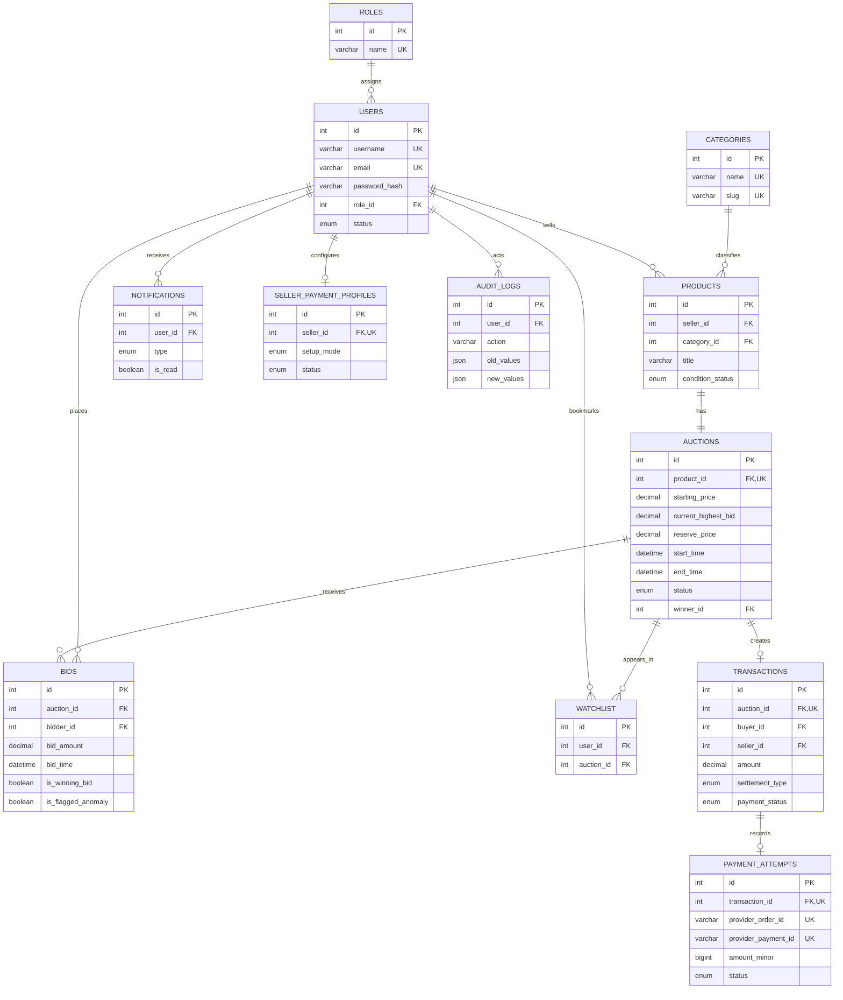

# BidSmart Analytics
## Pre-Project Documentation and Product Requirements

**Project title:** BidSmart Analytics — AI-Powered Online Bidding and Auction Intelligence Platform  
**Document type:** Pre-project documentation / product requirements document  
**Prepared:** 16 October 2026  
**Project status:** Application developed and deployed; this document records the verified repository baseline and separates implemented capabilities from proposed enhancements.  
**Intended audience:** Project mentors, academic evaluators, developers, and other stakeholders

> **Accuracy note:** The project name includes “AI-Powered,” but that label does not mean that a generative AI assistant, machine-learning fraud detector, WebSocket service, or Power BI report is currently implemented. The implemented baseline is described separately from planned work throughout this document. Deployment platforms and live URLs are supplied by the project owner; the repository contains configuration and deployment guidance but this document does not independently certify the availability or health of the live services.

## 1. Abstract

BidSmart Analytics is a web-based auction marketplace intended to bring product discovery, time-limited bidding, auction management, notifications, payment-state tracking, and business analytics into one platform. Buyers can browse listings and participate in eligible auctions; sellers can create and manage product listings and auctions; administrators can oversee users, auctions, categories, and transactions. The system is implemented as a React single-page application, a Python FastAPI REST API, and a MySQL relational database.

The core auction workflow includes server-side bid validation, serialized bid updates, minimum-increment rules, seller/buyer role restrictions, anti-sniping extensions, scheduled auction activation and closure, reserve-price evaluation, and outcome notifications. Role-scoped analytics summarize persisted products, auctions, bids, and verified demo payment settlements. Payment functionality is restricted in configuration and application code to Razorpay TEST mode; it is not evidence of live payment processing, escrow, or seller payouts.

The current analytics and interaction model is conventional application logic and database aggregation. The repository does not establish that an external AI model, natural-language analytics assistant, machine-learning anomaly detector, Power BI dashboard, persistent WebSocket connection, or backend watchlist API is implemented. These are treated as future work unless expressly identified as implemented below.

## 2. Problem Statement

An online auction combines a product catalog with a changing, time-constrained bidding process. Without a consistent system of record and server-side validation, auction applications can expose participants to inaccurate bid state, conflicting bids, unclear auction outcomes, and limited visibility into marketplace activity. Buyers also need a way to discover listings, monitor bids, and understand the result of auctions; sellers need tools to list products and manage sale schedules; and administrators need access to oversight functions.

The project addresses these workflow needs by centralizing catalog, auction, bidding, user access, notification, payment-state, and analytics functions. The existing project PRD also identifies auction integrity and decision-support as concerns. No measured market study, external benchmark, or quantified user-research result was located in the implementation materials, so this document does not claim a measured market impact.

## 3. Existing System and Its Limitations

### 3.1 Existing approach

The repository describes a deployed full-stack marketplace rather than a separate legacy software product being replaced. The implemented system already provides public catalog browsing, authenticated role-specific workflows, auction and bid APIs, dashboards, database-backed records, and analytics.

### 3.2 Current limitations and gaps

- Auction detail and notification updates use timed REST polling (documented intervals are 8 seconds for active auction details and 30 seconds for notification counts), not persistent WebSockets or push delivery.
- The watchlist table and ORM model exist, but the API router does not mount watchlist endpoints. Buyer bookmarks are stored in browser `localStorage`, scoped by user; they are not synchronized as server-owned records.
- The analytics dashboard uses deterministic server-side aggregations and Recharts visualizations. It is not a natural-language AI assistant, predictive model, or Power BI report.
- The bid schema has an anomaly-flag field and analytics can exclude flagged records. Repository evidence does not show an active detector assigning risk scores or an anomaly review workflow.
- Settlement records are identified as simulated demo settlement. Razorpay integration is constrained to TEST mode; no live-mode payments, real escrow, or seller disbursement is established.
- Shipping, fulfillment, and delivery tracking are not part of the verified application scope.
- Production availability, performance targets, scale limits, disaster-recovery guarantees, and independent security certification are not established by the repository evidence.

## 4. Proposed System and Objectives

BidSmart Analytics consolidates the auction lifecycle in an accessible web platform backed by a relational database and REST API. Its primary objectives are:

1. Provide public product and auction discovery with useful search, filtering, sorting, and pagination.
2. Enforce authenticated, role-appropriate access to buyer, seller, and administrator workflows.
3. Validate bids on the server and persist accepted bid and auction state changes safely.
4. Support scheduled auctions, clear outcomes for sold, unsold, reserve-not-met, and cancelled listings, and relevant in-app notifications.
5. Provide role-scoped analytics based on stored operational records, with date and category filters.
6. Track payment attempts and transaction state without presenting a test integration as live financial settlement.
7. Provide a maintainable architecture that can be extended with further intelligence features after those features are designed, implemented, and tested.

## 5. Project Scope

### 5.1 In scope

- User registration, login, profile management, and role-based access control.
- Product categories and seller-owned product listings.
- Auction creation and lifecycle management.
- Buyer bidding, bid history, minimum bid increments, anti-self-bidding controls, and bid-history identity masking.
- Auction scheduling/closing, reserve-price checks, notifications, and demo transaction tracking.
- Role-aware buyer, seller, and administrator dashboards.
- Catalog search/filter/sort/pagination and responsive web navigation.
- Role-scoped analytics, including KPIs, category performance, rankings, status distribution, and daily/monthly trends.
- Razorpay TEST-mode order/payment verification and webhook handling, subject to test-mode configuration and provider credentials managed outside source control.
- Automated tests for backend APIs/services and frontend components/pages.

### 5.2 Out of scope or not verified as implemented

- Live card/bank payments, production payment mode, custody/escrow, refunds, chargebacks, or actual seller payouts.
- Physical shipping, logistics, and parcel tracking.
- Persistent WebSockets, server-sent events, or guaranteed sub-second live updates.
- A production generative-AI assistant, open-ended natural-language query execution, or external LLM integration.
- A trained or active machine-learning fraud/anomaly detector or automated enforcement based on anomaly scores.
- Power BI dashboards, a separate Python/pandas analytics pipeline, or predictive price recommendations.
- Native mobile applications.
- A server-backed watchlist API (the current client bookmark feature uses `localStorage`).
- Claims of quantitative fraud reduction, increased sales, high-volume capacity, or formal security/compliance certification without separate evidence.

## 6. Functional Requirements

The following requirements describe the implemented product baseline unless marked as a future enhancement.

| ID | Requirement | Implementation status |
|---|---|---|
| FR-01 | Visitors can browse the home page and auction catalog, search by keyword, and apply category, status, condition, sorting, and pagination controls. | Implemented in the frontend and catalog APIs. |
| FR-02 | A user can register and authenticate; the API issues and validates bearer-token credentials and exposes authenticated profile operations. | Implemented; role and active-account checks apply to protected operations. |
| FR-03 | Sellers can manage their own products and auctions, including scheduling and lifecycle controls. | Implemented through seller UI and product/auction endpoints. |
| FR-04 | Only eligible buyers can place bids; the server validates auction availability, ownership restrictions, starting price, and minimum increment. | Implemented in the bidding API/service path. |
| FR-05 | Concurrent bid updates are serialized and accepted bid state is persisted consistently. | Implemented using database transaction/row-locking logic; the schema also defines a stored procedure. |
| FR-06 | A bid near the scheduled end may extend the auction under the configured anti-sniping rule. | Implemented; repository documentation specifies a 30-second threshold and 60-second extension. |
| FR-07 | Bid history is available with role-aware bidder identity masking. | Implemented by the bid history endpoint. |
| FR-08 | Expired auctions can be activated/closed, resolved against reserve conditions, and represented by a terminal status. | Implemented through lifecycle services and a configurable scheduler. |
| FR-09 | Users can view and manage their in-app notifications, including unread counts and read status. | Implemented; client badge refresh uses REST polling. |
| FR-10 | Users can view analytics within their permitted scope and filter by date range and category. | Implemented in the analytics endpoint and dashboard. |
| FR-11 | Buyers can track won auctions and payment history; eligible winners can create/verify payment attempts in TEST mode. | Implemented as a test-mode payment workflow; not a live payment service. |
| FR-12 | Buyer, seller, and administrator dashboards expose role-relevant operations. | Implemented with frontend route guards and API authorization. |
| FR-13 | Buyers can bookmark auctions. | Implemented in the browser via user-scoped `localStorage`; server persistence is not implemented. |
| FR-14 | The system provides an AI-generated analytics assistant and automated anomaly detection. | **Not implemented; future enhancement.** |

## 7. Non-Functional Requirements

These requirements express the expected quality attributes and observed safeguards. Where the repository does not define measurable targets, no numeric service-level promise is made.

- **Security:** Protect passwords using bcrypt hashing; use signed bearer tokens; apply active-user and role checks on protected operations; keep provider/database/token secrets in deployment configuration rather than frontend source.
- **Data integrity:** Use MySQL/InnoDB relational constraints, foreign keys, unique constraints, transactions, and row-level locking for sensitive auction state transitions.
- **Privacy:** Restrict records by user/role scope; mask bidder identities for public/competing views; do not expose private reserve values to unauthorized roles.
- **Reliability:** Provide health checks, explicit API error responses, lifecycle idempotency protections, and a configurable scheduled auction worker.
- **Maintainability:** Separate frontend API clients, pages/components, backend routes/schemas/services/models, and database migrations.
- **Usability:** Provide responsive browser UI, clear role-specific pages, form validation, and notification views.
- **Performance:** Use indexes and bounded pagination where implemented. No independently verified latency, throughput, availability, or auction-volume target is claimed.
- **Compatibility:** The frontend uses a Vite build and SPA routing; backend requirements document supported modern Python versions and MySQL-compatible relational storage.

## 8. User Roles and Use Cases

| Role | Primary use cases | Key restrictions |
|---|---|---|
| Visitor | Browse home page/catalog and view public auction details. | Cannot submit bids or access private account dashboards. |
| Buyer | Register/login, browse, bid, review bid/win activity, receive notifications, view analytics, and access eligible test-mode checkout/payment history. | Cannot bid as seller/admin; may only access their own protected buyer/payment records. |
| Seller | Create and manage products and auctions, monitor bids/reserve information for own listings, close eligible own auctions, receive outcome notifications, and view seller-scoped analytics. | Cannot place bids; listing ownership and seller authorization are enforced. |
| Administrator | Oversee users, categories, auctions, and transactions; access broad analytics; perform authorized administrative lifecycle operations. | Administrative privileges are restricted to protected admin routes; admin bidding is prohibited. |

### Representative use cases

1. **Find and bid:** A buyer filters the catalog, opens an auction, authenticates if required, submits a bid, and receives the server's accepted/rejected result. The client refreshes active auction data through REST polling.
2. **List and close an item:** A seller creates a product and auction, monitors activity, and receives a notification when the auction closes. Winner/reserve rules determine its outcome.
3. **Review marketplace activity:** An administrator selects date/category filters and reviews KPI, status, category, trend, and ranking views.
4. **Complete a test-mode payment:** A winning buyer opens checkout; the API derives the due amount from the stored transaction and uses Razorpay TEST-mode order/verification paths. This does not constitute a live payment or seller payout.

## 9. Technology Stack and Selection Rationale

| Layer | Technology | Rationale in this project |
|---|---|---|
| Frontend | React 19, JavaScript, Vite | Component-based SPA and fast development/production builds. |
| Styling | Tailwind CSS v4 | Utility-based styling used by the existing responsive interface. |
| Routing | React Router v7 | Client-side routes and role-gated dashboard navigation. |
| HTTP/data access | Axios | Central API client handles the `/api/v1` base path, bearer token attachment, and API errors. |
| Charts | Recharts | React-compatible charts for trend, category, and dashboard visualizations. |
| Backend API | Python 3.11+ and FastAPI | Typed REST interfaces, request validation, dependency injection, and generated OpenAPI documentation. |
| Persistence/ORM | SQLAlchemy 2 and PyMySQL | Python ORM and MySQL-compatible database access with transaction support. |
| Database | MySQL 8+/Aiven MySQL; schema also documents MariaDB compatibility | Relational constraints and transactional storage fit users, products, auctions, bids, and settlements. |
| Authentication/security | bcrypt, Python-Jose JWT, Pydantic settings | Password hashing, signed tokens, configuration validation, and role-aware authorization. |
| Backend testing | pytest, FastAPI TestClient/httpx | Isolated API/service tests; explicitly opted-in MySQL tests are separated from ordinary tests. |
| Frontend testing | Vitest, React Testing Library, JSDOM | Component, page, and API-facing behavior tests without a real browser. |
| Frontend hosting | Vercel (reported by project owner) | Static SPA hosting; repository includes Vercel SPA rewrite configuration. |
| Backend hosting | Render (reported by project owner) | FastAPI service hosting; backend README documents health-check and production configuration. |
| Database hosting | Aiven MySQL (reported by project owner) | Managed MySQL; backend documentation describes CA-based TLS configuration for Aiven. |

## 10. System Architecture and Workflow

### 10.1 Architecture

The frontend communicates with the FastAPI service over REST. The backend is the authority for bid validation, auction state, authorization, and payment amount/state. Persistent business data is stored in MySQL. The backend configuration exposes a scheduler setting; when enabled, it activates scheduled auctions and checks expired auctions at the configured interval. Razorpay connectivity is restricted to test mode. The hosting/provider names in this diagram reflect the project-owner deployment description and repository deployment guidance.

### 10.2 Representative bidding and closing workflow

### 10.3 Auction outcome workflow

An eligible bid updates the current high bid and the winning bidder under transaction/locking protections. An auction closure evaluates bid presence and reserve conditions. It can resolve to completed, unsold, reserve-not-met, or cancelled states. Completed outcomes create a demo settlement transaction for the winner and notify affected parties. Payment attempts are separate from auction winner resolution and remain in TEST mode.

## 11. Database Design and Major Entities

The database uses normalized relational tables with primary/foreign keys, indexes, uniqueness constraints, and MySQL `DECIMAL` values for monetary amounts. Schema and migration files are the source evidence; the ERD overview below omits some payment lifecycle details for readability.

Major entities:

- **Roles and users:** User identity, bcrypt password hash, role, status, and profile attributes.
- **Categories and products:** Classification and seller-owned listing information.
- **Auctions:** Pricing, time window, lifecycle status, current winner, reserve, and bid aggregate.
- **Bids:** Per-bid records, bid timestamp, current-winning marker, and anomaly flag field.
- **Notifications and audit logs:** User-facing lifecycle notifications and administrative/security event records.
- **Transactions and payment attempts:** Demo settlement/payment state, provider order/payment identifiers, and amount/currency consistency checks.
- **Watchlist and seller payment profiles:** Database models exist; watchlist data currently lacks mounted API endpoints, and seller payment setup is simulated/demo-oriented and feature-flagged in configuration.
- **Payment webhook events:** Stores processed provider event identifiers/types for deduplication; it does not imply that payment was made in live mode.

## 12. API and Frontend Module Overview

### 12.1 Backend API

FastAPI mounts versioned routes under `/api/v1`; interactive OpenAPI documentation is exposed by the application.

| API area | Main responsibility |
|---|---|
| Health | Root and versioned health status/diagnostics. |
| Authentication | Registration, login, token workflows, and authenticated identity. |
| Users | Profile and administrative user/role management. |
| Categories and products | Catalog taxonomy and product listing operations. |
| Auctions | Auction discovery, detail, seller management, closing, and lifecycle operations. |
| Bids | Place bids, inspect auction bid history, and retrieve buyer bid activity. |
| Notifications | Inbox, unread count, mark-one-read, and mark-all-read operations. |
| Analytics | Authenticated, role-scoped analytics with date/category filters. |
| Payments | Winner payment eligibility, order creation, provider verification, webhook handling, and payment history. |
| Seller payment setup | Demo seller setup endpoints; configuration includes a feature flag that defaults to disabled. |

There is no mounted `/api/v1/watchlist` router in the API aggregator.

### 12.2 Frontend modules

The React application includes public home, catalog, and auction detail pages; login/registration; buyer, seller, and admin dashboards; analytics; notification and profile pages; and payment checkout/history and admin transaction pages. Shared contexts manage authentication, notifications, and browser-local watchlists. Route guards restrict dashboards and payment views by role. An Axios client handles API requests and authentication headers.

## 13. Analytics and Business Intelligence

The implemented analytics feature is an application dashboard backed by `GET /api/v1/analytics`. The API allows date-range and category filtering, applies role-based scope (marketplace-wide for administrators, owner-specific for sellers, and activity-specific for buyers), and uses UTC date basis.

The response includes role-relevant KPI values such as products, auctions, active/upcoming/completed/cancelled auctions, recorded and valid bids, participation/wins, watchlist counts, and completed demo settlement metrics where the payment-attempt schema supports verification. It also provides auction-status distributions, category performance, product/auction rankings, and daily/monthly activity trends. The frontend presents these as KPI cards, line/bar/pie charts, and sortable ranking tables.

Settlement analytics are intentionally based on verified backend payment state and require the expected payment-attempt lifecycle schema. Missing required payment schema is reported as unavailable rather than silently represented as zero settlement activity.

`database/queries/analytics_queries.sql` additionally contains a suite of example/reporting SQL, including category performance, rankings, monthly trends, and cumulative analyses. The presence of these SQL queries is not proof of a separately deployed BI warehouse, Python data-science pipeline, or Power BI dashboard.

## 14. AI Features: Implemented Versus Planned

### Implemented and verified in the repository

- Deterministic analytics queries and aggregations in the FastAPI analytics endpoint.
- A database field (`is_flagged_anomaly`) that can mark bids and analytics logic that can exclude marked bids from valid-bid counts.
- Standard, rule-based marketplace behavior such as minimum-bid checks, reserve evaluation, and anti-sniping extensions.

These functions are not generative AI or machine learning.

### Planned, incomplete, or not evidenced as implemented

- A natural-language AI analytics assistant or production connection to OpenAI/another external model.
- AI-generated recommendations, price forecasts, or conversational analytics.
- An active anomaly-detection rule engine, trained model (including Isolation Forest), explainability scores, or administrator anomaly-review queue.
- Microsoft Power BI reports, DAX model, or automated BI publishing.
- A Python/pandas/NumPy data-science pipeline.

The backend configuration includes optional OpenAI-related settings, but configuration fields alone do not implement an AI feature. No AI assistant route, assistant UI, model invocation, trained detector, or Power BI deliverable was identified in the inspected implementation. Such functionality should be treated as future scope and only represented as complete after implementation and validation.

## 15. Security and Access Control

- **Authentication:** Passwords are stored as bcrypt hashes; bearer JWT access tokens are used for authenticated API requests. The backend configuration defines an HS256 algorithm and token lifetimes.
- **Authorization:** The application uses BUYER, SELLER, and ADMIN roles with active-account checks and protected frontend routes. API authorization remains authoritative; frontend route guards are not a substitute for backend checks.
- **Auction integrity:** The backend enforces role restrictions, anti-self-bidding, auction timing/status, minimum increments, and database transaction/locking controls. Bid history masks bidder identity for unauthorized viewers.
- **Data privacy:** Buyer records and payment history are scoped to the authenticated buyer; seller operations are constrained to owned listings; admin transaction access is restricted.
- **Secrets:** Production secrets, database credentials, payment provider keys, and webhook secrets must be configured in backend deployment secret settings, not committed or embedded in `VITE_` variables. No secret values are included in this document.
- **Transport/database configuration:** Deployment guidance calls for explicit production CORS origins and a CA certificate with hostname verification for Aiven database connections.
- **Payment verification:** Payment amounts are derived from server transaction state; payment verification and signed webhook routes are present in code but are configured for Razorpay TEST mode only.

This document is not a penetration-test report or certification of the deployed environment.

## 16. Testing and Validation Performed

### Repository test coverage

The backend has pytest suites for analytics, authentication, auctions, bids, products, notifications/closing, payments, database/model behavior, scheduler behavior, configuration, health checks, and regression/safety cases. The backend fixtures create isolated test data; MySQL-specific concurrency/database tests require explicit opt-in to a disposable database. The frontend has Vitest/React Testing Library suites for analytics, authentication, auctions, payments, seller payment setup, pages, components, and release-safety behavior.

### Targeted validation executed for this document

| Test | Result |
|---|---|
| `py -m pytest -q tests\test_analytics.py` from `backend\` | **Passed:** 21 tests. One deprecation warning reported for a FastAPI status constant. |
| `npm test -- --pool=threads --maxWorkers=1 src/test/analytics.test.jsx` from `frontend\` | **Passed:** 1 test file, 7 tests. |

The first default-pool frontend attempt timed out while starting a worker; the targeted retry passed using one thread. These are focused analytics checks, not a claim that the full backend/frontend test suites or the live deployment were validated in this task. No MySQL production/concurrency test, live payment transaction, load test, or security penetration test was run.

## 17. Deployment Architecture

The project owner identifies the live frontend as [bidsmart-analytics.vercel.app](https://bidsmart-analytics.vercel.app/) and the source repository as [meghangowdru-debug/BidSmart-Analytics](https://github.com/meghangowdru-debug/BidSmart-Analytics). The stated deployment stack is Vercel for the frontend, Render for FastAPI, and Aiven MySQL for the database.

Repository configuration and deployment guidance support this layout:

1. Vercel serves the React/Vite production build and rewrites client-side paths to the SPA entry point.
2. The frontend is configured to use a backend base URL supplied through the build environment; the Axios client adds `/api/v1`.
3. Render hosts the FastAPI service and uses `/health` for service health checks. Production mode, explicit CORS origins, and secret values are configured as deployment environment settings.
4. The backend connects to Aiven MySQL using TLS CA/hostname verification as documented in backend deployment guidance.
5. Razorpay is restricted to TEST mode. The deployment setup must keep provider credentials on the backend and must not expose secrets to the Vite frontend.

The exact running release, cloud settings, database contents, and production health were not independently inspected as part of this documentation task.

## 18. Limitations and Future Enhancements

### Current limitations

- Browser-local watchlist data is device/browser-specific and is not a server-synchronized user feature.
- Polling introduces update delay and repeated requests compared with a push-based channel.
- Analytics are limited to implemented aggregations and persisted application records; historical quality depends on the records available.
- AI, predictive analytics, automated anomaly identification, Power BI, and real-time push channels are not verified features.
- Payments are test-mode only and do not provide actual settlement to sellers.
- The repository does not establish production SLAs, formal compliance certification, or independent security-review results.

### Recommended future work

1. Add authenticated watchlist endpoints and persistence, with migration, ownership checks, and frontend integration.
2. Define an explicit availability/performance target and perform representative load and concurrency testing against a disposable environment.
3. Evaluate a push update mechanism (WebSockets or server-sent events) only if the latency and operational requirements justify it.
4. Design explainable anomaly-detection rules with labeled test cases and human review before any enforcement; avoid automated penalties based only on model output.
5. If an AI assistant is pursued, implement a narrow, authenticated tool interface that invokes approved analytics functions, disclose provenance, test prompt-injection resistance, and avoid arbitrary SQL execution.
6. Add Power BI or another BI deliverable only as a separate validated integration with agreed metric definitions and reconciliation tests.
7. Pursue live payment processing only after provider production approval, security/legal review, webhook/idempotency testing, operational monitoring, and a clearly designed payout/refund lifecycle.
8. Improve observability, backup/restore drills, migration automation, and service-level monitoring for production operations.

## 19. Conclusion

BidSmart Analytics is an implemented full-stack auction marketplace with public discovery, role-aware account and auction workflows, transactional bidding controls, notifications, payment-state handling, and database-backed analytics. Its core architectural value is the consolidation of marketplace operations and deterministic reporting behind a REST API and MySQL data model. The current implementation should be evaluated on those verified capabilities; the “AI-powered” positioning represents a future direction rather than evidence of an operational AI subsystem. This document provides an implementation-grounded baseline suitable for project mentoring and academic review while identifying gaps and responsible next steps.

## 20. References

1. [BidSmart Analytics source repository](https://github.com/meghangowdru-debug/BidSmart-Analytics).
2. [BidSmart Analytics live website](https://bidsmart-analytics.vercel.app/), URL supplied by the project owner.
3. [Existing project PRD](../BidSmart_Analytics_PRD.md) — broader requirements and proposals; not all proposals are implemented.
4. [Backend README](../backend/README.md) — backend architecture, API behavior, testing and deployment guidance.
5. [Frontend README](../frontend/README.md) — page inventory, polling behavior, integration gaps, and frontend setup.
6. [Database README](../database/README.md) and [database ERD](../database/ERD.md) — data model and database behavior.
7. [MySQL schema](../database/schema.sql), [analytics SQL queries](../database/queries/analytics_queries.sql), backend API routes, and relevant backend/frontend tests in the repository.
